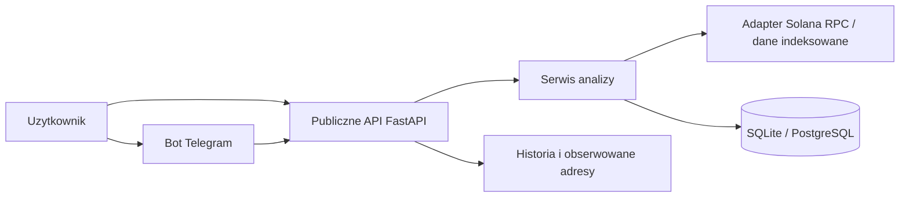

# Karta projektu: Token AI ($TAI)

## 1. Nazwa i opis

**Token AI ($TAI)** to aplikacja analityczna dla traderow ekosystemu Solana. Uzytkownik przekazuje adres portfela albo adres kontraktu tokena (CA), a system porzadkuje publiczne dane on-chain w czytelny raport. Raport pokazuje obserwowalne przeslanki: aktywnosc, czas wejscia, koncentracje posiadaczy, plynnosc i potencjalne ryzyka. Produkt wspiera research, nie prognozuje ceny i nie udziela porady inwestycyjnej. Pierwszym interfejsem bedzie bot Telegram, wspierany przez publiczne API.

## 2. Zespol i role

| Osoba | Rola | GitHub login |
| --- | --- | --- |
| Jakub Rossa | Lider | [Rosolek11](https://github.com/Rosolek11) |
| Filip Dejer | Tester | do uzupelnienia |
| Jakub Makutynowicz | Developer | do uzupelnienia |
| Michal Maszalo | Developer | do uzupelnienia |

Lider odpowiada za priorytety, komunikacje z prowadzacym, utrzymanie backlogu i usuwanie blokad. Tester przygotowuje strategie testow, przypadki testowe i pilnuje jakosci przed scaleniem. Deweloperzy implementuja API, integracje z danymi on-chain oraz interfejs Telegram, wspolnie wykonujac review kodu.

## 3. Uzytkownicy (persony)

1. **Aktywny trader memecoinow** - potrzebuje szybko sprawdzic, czy ruch portfela lub tokena ma rozpoznawalny kontekst, zanim rozpocznie wlasny research.
2. **Poczatkujacy analityk Solany** - chce czytelnego raportu zamiast samodzielnego laczenia explorerow i surowych transakcji.
3. **Moderator spolecznosci tradingowej** - obserwuje kilka adresow i chce wracac do historii analiz podczas dyskusji o ryzyku tokenow.

## 4. Zakres funkcjonalny (MoSCoW)

### Must have - MVP na tydzien 7

- Przyjecie adresu portfela i token CA przez API oraz komendy bota Telegram.
- Walidacja formatu adresu Solany i pobranie podstawowych danych przez adapter RPC/dostawcy danych.
- Raport portfela: aktywa, liczba transakcji, proste metryki aktywnosci i opis przeslanek wzorca.
- Raport tokena: podstawowe dane, koncentracja posiadaczy, plynnosc (jesli dostepna) i lista ryzyk.
- Zapis analizy i historia ostatnich zapytan uzytkownika.
- Informacja, ze raport nie jest porada inwestycyjna.

### Should have

- Lista obserwowanych adresow i ponowne uruchamianie analizy.
- Proste oceny ryzyka z uzasadnieniem, bez rekomendacji kupna/sprzedazy.
- Cache odpowiedzi i ograniczenie czestosci zapytan.

### Could have

- Wykres aktywnosci w czasie.
- Eksport raportu do Markdown/PDF.
- Powiadomienia o zmianie obserwowanego adresu.

### Won't have (w tym projekcie)

- Automatyczny trading, custody srodkow, portfel kryptowalutowy.
- Gwarancje wyniku inwestycyjnego lub sygnaly kupna/sprzedazy.
- Wlasny token, sprzedaz tokenow, platnosci w TAI i automatyczny burn.

## 5. Wymagania niefunkcjonalne

- **Bezpieczenstwo:** sekrety przechowywane tylko jako GitHub Actions Secrets/zmienne srodowiskowe; brak prywatnych kluczy i danych logowania w repozytorium.
- **Wydajnosc:** cached response dla powtornego zapytania, docelowy czas odpowiedzi MVP do 10 s przy dostepnym dostawcy danych.
- **Niezawodnosc:** blad dostawcy danych daje czytelny komunikat, nie nieprawdziwy raport.
- **Dostepnosc:** interfejs Telegram i publiczne API HTTP; komunikaty zrozumiale po polsku lub angielsku.
- **Zgodnosc:** aplikacja przedstawia dane i ograniczenia; nie jest usluga doradztwa inwestycyjnego.

## 6. Stos technologiczny

| Obszar | Wybor | Uzasadnienie |
| --- | --- | --- |
| Backend/API | Python 3.11 + FastAPI | Szybkie, typowane API z automatyczna dokumentacja OpenAPI i prostymi testami. |
| Baza danych | SQLite w MVP, PostgreSQL przy wdrozeniu | SQLite upraszcza start; PostgreSQL daje bezpieczna sciezke rozwoju. |
| Integracja danych | Solana JSON-RPC + dostawca indeksowanych danych | Dane sa publiczne, a adapter pozwoli zmienic dostawce bez zmiany logiki. |
| Bot | Telegram Bot API | Zgodne z koncepcja produktu i wygodne dla traderow. |
| Testy | pytest + FastAPI TestClient | Szybkie testy jednostkowe i API w pipeline. |
| CI/CD | GitHub Actions | Natywne dla wybranego hostingu repozytorium. |
| Wdrozenie | Render/Fly.io lub kontener Docker | Decyzja po Sprint 0, zalezy od limitow i kosztow. |

## 7. Architektura

Backend izoluje dostawce danych w adapterze. Pozwala to testowac logike na przygotowanych odpowiedziach oraz wymienic RPC bez zmiany endpointow i bota.

## 8. Strategia testow

Tester utrzymuje przypadki testowe oraz kryteria wyjscia ze sprintu. Stosujemy:

- testy jednostkowe: walidacja adresow, obliczanie metryk i klasyfikacja ryzyk;
- testy integracyjne: adapter danych na zapisanych odpowiedziach oraz repozytorium bazy;
- testy API: statusy, walidacja i format raportu;
- testy manualne/UAT: scenariusze Telegram dla portfela, tokena, bledu i historii;
- smoke test po wdrozeniu: `/health` i podstawowa analiza na znanym adresie.

GitHub Actions uruchamia `pytest` dla kazdego Pull Request i push do `main`. PR nie jest gotowy bez zielonego CI i review.

## 9. Ryzyka i ograniczanie

| Ryzyko | Wplyw | Ograniczenie |
| --- | --- | --- |
| Limit lub awaria RPC | Brak niektorych raportow | Timeouty, komunikat bledu, cache i wymienny adapter dostawcy. |
| Zbyt szeroki zakres analizy | Niedowiezione MVP | Koncentracja na dwoch typach analizy i prostych metrykach; tokenomia poza zakresem. |
| Bledna interpretacja danych przez uzytkownika | Ryzyko decyzji finansowej | Jawne przeslanki, zrodla danych i staly disclaimer; brak rekomendacji. |
| Nieznajomosc Telegram/Solana API | Opoznienie Sprintu 0 | Spike techniczny, dokumentacja, mala integracja proof-of-concept. |
| Sekrety w historii Git | Utrata bezpieczenstwa | `.gitignore`, GitHub Secrets, review i natychmiastowa rotacja przypadkowo ujawnionego sekretu. |

## 10. Plan sprintow

| Sprint | Cel | Must have |
| --- | --- | --- |
| Sprint 0 (tydzien 3) | Szkielet i jakosc | Repo, CI, `/health`, model danych, spike RPC/Telegram. |
| Sprint 1 (tygodnie 4-5) | Pierwszy pelny przeplyw | API portfela, zapis historii, raport podstawowych metryk, testy. |
| Sprint 2 (tygodnie 5-6) | Analiza tokena i bot | API tokena, ryzyka, komendy Telegram, lista obserwowanych. |
| Sprint 3 (tydzien 7) | Dopracowanie MVP | Obsluga bledow, cache, UAT, dokumentacja wdrozenia i demo. |

## 11. Zasady zespolu

Obowiazuje Definition of Done, code review i konwencje opisane w [zasady-zespolu.md](zasady-zespolu.md). Kazda zmiana trafia do `main` przez Pull Request, z co najmniej jednym zatwierdzeniem oraz zielonym CI. AI jest narzedziem wspierajacym - autor weryfikuje wynik i nie przekazuje mu sekretow.
